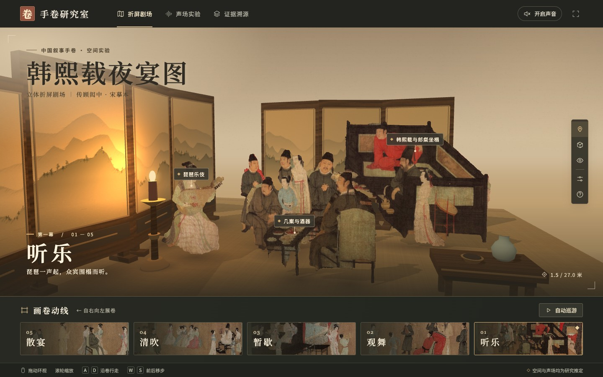
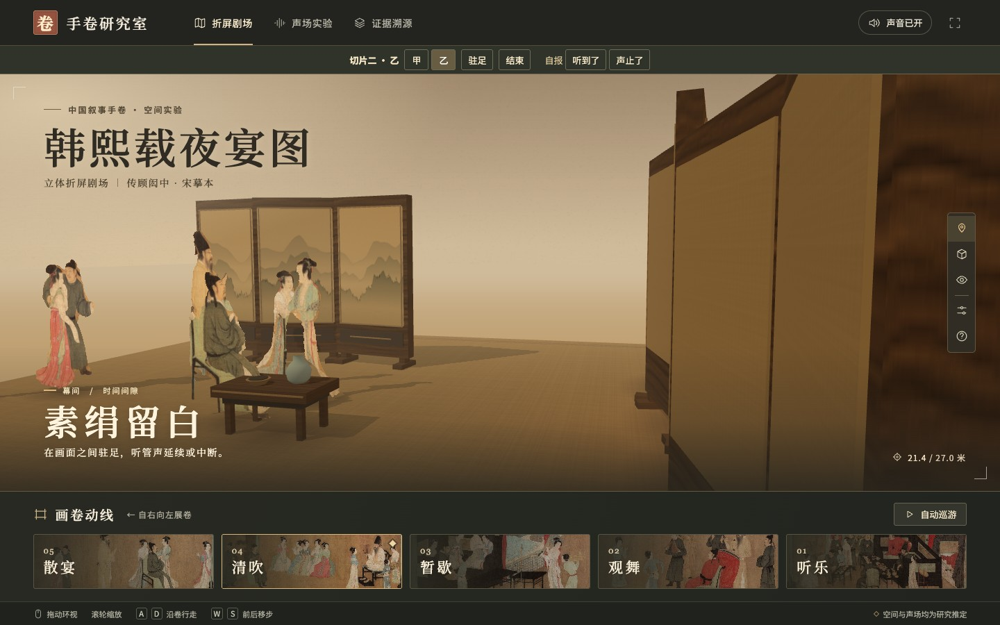
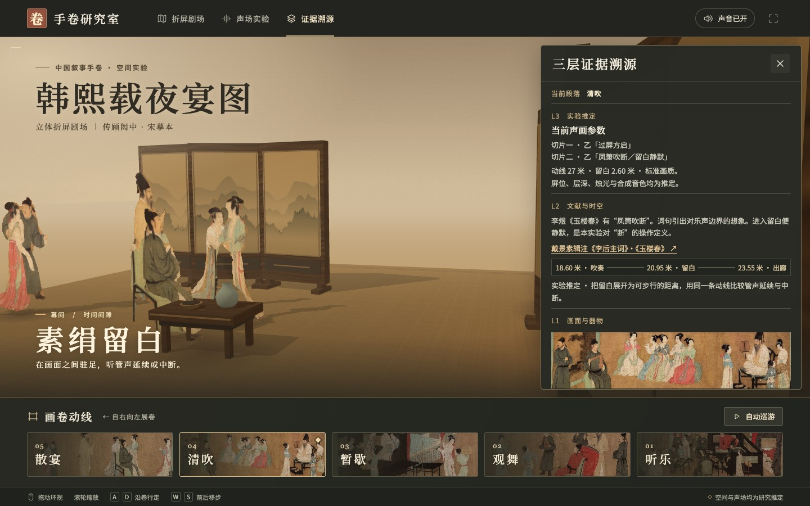
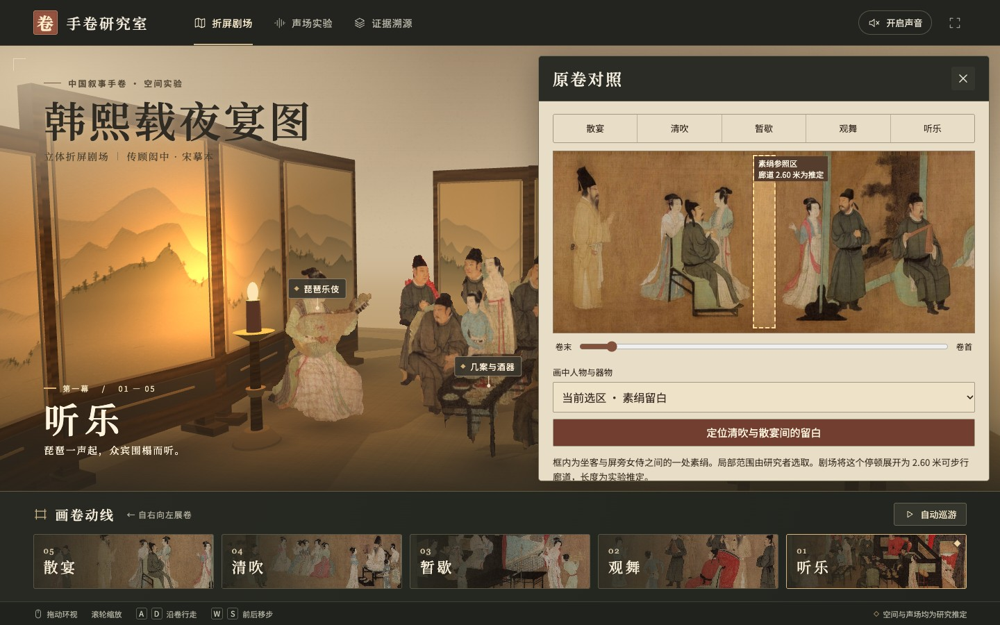
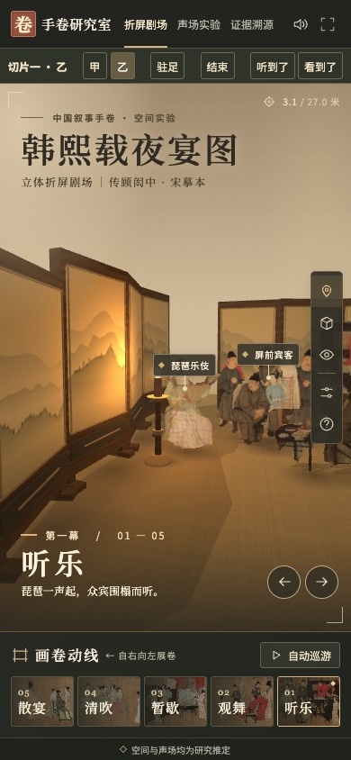

# 韩熙载夜宴图 · 折屏剧场

**GPT-6 Astra 实际使用体验测试**。本仓库记录一次从中文研究提示词到可公开运行的 Three.js 前端实验。研究问题是，当观者可以绕屏、驻足和回退时，同一段鼓声或管声的起止边界，会怎样改变对手卷事件先后的判断？可检查的成果包括源码、图像轮廓、实验参数、真实浏览器截图和自动校验。

**[在线进入折屏剧场](https://w399651114-oss.github.io/night-revels-theatre/)** · [完整任务提示词](docs/提示词.md) · [构建与部署记录](https://github.com/w399651114-oss/night-revels-theatre/actions/workflows/pages.yml)



## 第一次观卷

页面从右端“听乐”开始。点“开启声音”，听琵琶弹拨；按住 **A 或 ←** 向左行走，松手驻足，**D 或 →** 回退。相机沿开放的 27 米素绢长廊绕过四道实体折屏。**W / S** 改变远近，拖动环视，滚轮缩放，右键拖动平移。手机可按住行进键、拖动环视和双指捏合。

想直接体验研究问题，可打开 **声场实验 → 切片二 → 甲 → 从同一起点试听**。进入清吹与散宴之间的留白时听管声，再换乙从相同位置重走一次。两遍都使用同一份音轨、同一镜头和走速。

| 可运行内容 | 在哪里体验 |
| --- | --- |
| 五段叙事与五个深度带 | 底部自右向左依次为听乐、观舞、暂歇、清吹、散宴。点任一画面平滑定位 |
| 两个甲乙实验 | 听乐至观舞比较“别殿遥闻／过屏方启”；清吹至散宴比较“余音越界／凤箫吹断、留白静默” |
| 人物与器物 | 点画面题签读简介，选“走近看看”。证据区保留本段完整索引 |
| 原卷与动作 | 原卷可横移、切幕、框选原画中的人物与器物、定位留白。鼓槌、拨弦腕、舞袖、管身有独立支点 |
| 逐次记录 | 开始试听后可驻足、回退、切甲乙，点“听到了”“看到了”或“声止了”。从实验面板下载带顺序、轨迹和自报时间的 JSON |
| 三层证据 | 证据溯源面板并列 L3 当前参数、L2 诗词题跋与时空图解、L1 原画局部与器物 |
| 巡游与观察 | 自动巡游会在各幕驻足；支持全屏、隐藏界面、标签、线框与三档画质 |
| 导出 | 视图与导出可下载 4K PNG、录制合成声画、保存当前参数 JSON。文件由浏览器下载 |



<details>
<summary>查看证据面板和移动视口实测图</summary>







</details>

## 本机运行与离线打开

建议使用 Node.js 24。Three.js 锁定为建库时 npm 稳定标签 **0.187.0**，Vite 为 **8.3.8**。

```sh
git clone https://github.com/w399651114-oss/night-revels-theatre.git
cd night-revels-theatre
npm ci
npm test
npm run build
```

**双击 dist/离线画卷.html 即可打开**，可单独复制给其他电脑，也可双击构建目录中的 index.html。需要开发热更新时运行 npm run dev；在本机查看静态网站时运行 npm run preview。初次安装依赖需要网络，离线版的渲染、字体、图像和声音都在本机完成。

## 体验测试记录与局限

- **从平卷到空间。** 28 张透明原画裁片按五个深度带排布。合批木构、器皿、接触阴影和实体屏扇提供近景参照。侧身近看能辨认出画片厚度接近零。三处原裁片遮挡补绘与四个活动局部的拆片、补色均有制作说明。
- **版本切换。** 甲乙复用同一合成音轨，相位可保持或重置。播放包络、减衰、音符、米制、屏端路径和动作摆幅都是研究推定。原画无法给出宅第尺寸、历史演奏录音或参与者的真实听感。
- **声画实测。** 乙版随舞者实际揭帧开启。1440 × 900 和 390 × 844 视口下，首次揭帧分别在 3.688 米、3.709 米，声部 PCM 均在其后约 16 毫秒第一次检出。两种视口的试听控制条与画布重叠均为 0 平方像素。手机部分使用同一台 Mac 的触屏视口模拟。[测量方法与逐次结果](docs/实验复核.md)
- **完整巡游。** Apple M1 Pro / 16 GB、Chrome 157、ANGLE Metal、标准档，从 1.5 米走到 27 米，共 47.06 秒。1440 × 641 绘图缓冲，平均 59.94 fps，帧间隔 P95 为 16.8 毫秒。此次只使用这一台机器，真实手机和其他 GPU 的表现待测。
- **4K 操作实录。** 1 分 49 秒，包含网页界面、点击、走近、原卷定位、四次固定条件试听、记录下载及窄屏操作。2620 帧逐帧解码为 3840 × 2160，24 fps，48 kHz 立体声。原始标签页采集平均 28.07 fps，最长帧间隔约 300 毫秒。原始录屏和 MP4 成片留在本地，可用仓库脚本重新录制。[试听时码与同音量测量](docs/4K分镜与验收.md) · [录制命令](docs/4K实录与复验.md)
- **复现范围。** 仓库保存了此次测试的任务与交付产物，前端运行无需模型账户。使用体验数据限于本项目流程，尚未开展受试者实验或模型间对照。

## 制作、校验与许可

| 资料 | 内容 |
| --- | --- |
| [实现与重建](docs/实现与重建.md) | 走廊坐标、屏端绕行、视差、几何合批、声音合成公式与两组实验边界 |
| [原画素材与许可](docs/原画素材与许可.md) | 公版来源、手工轮廓、局部补绘、扫描图和母版的校验值、离线重建 |
| [原卷对照与人物动作](docs/原卷对照与人物动作.md) | 全卷坐标、留白取样、四个支点、拍头与休止 |
| [考据与推定](docs/考据与推定.md) | 故宫著录、班惟志题诗、李煜词句及操作定义的证据边界 |
| [部署与 4K 剪辑](docs/部署与录制.md) | 干净克隆、GitHub Pages 子路径、浏览器验证、录制和转码、哪些文件留在本地 |
| [第三方声明](docs/第三方声明.md) | 框架、字体、图像与制作工具的来源和许可 |

程序源码采用 [MIT 许可](LICENSE)。原画数字复制品、字体及第三方组件各循所列许可。运行资产包含本地画片与字体，模型由源码生成，WebP 由浏览器原生解码。
