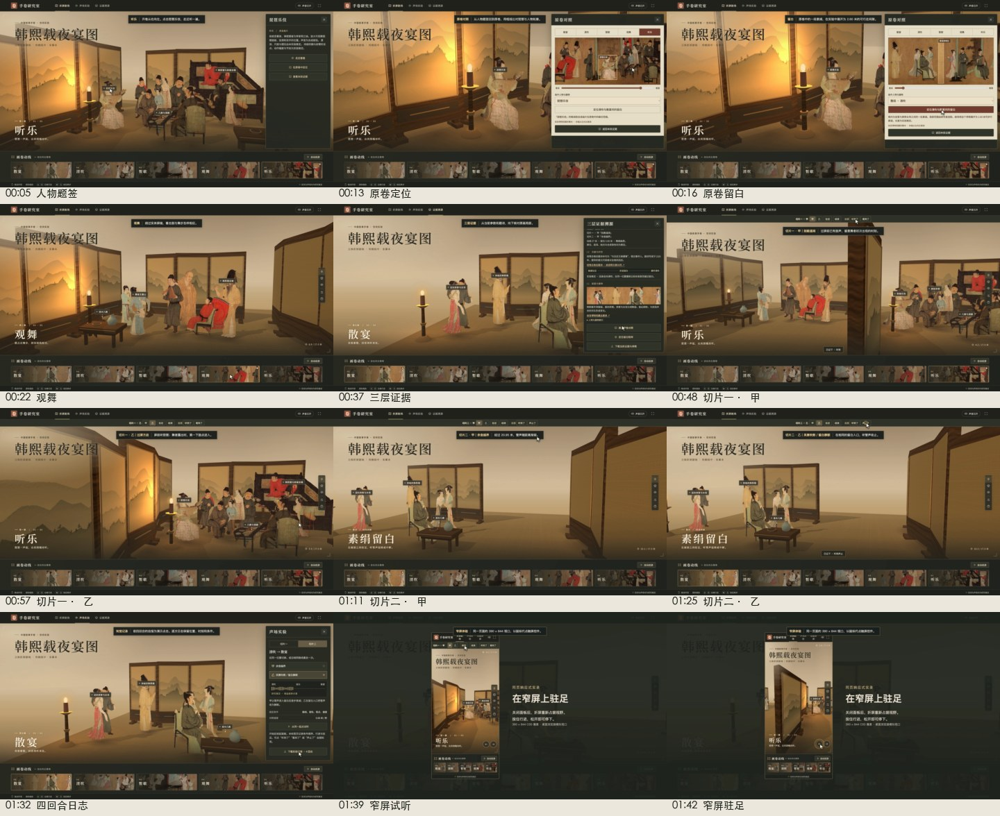

# 4K 实录镜头表与机器验收

本次成片由 Apple M1 Pro、16 GB 内存的 MacBook Pro 运行 Chrome 157.0.8103.79 录得。时长 109.167 秒，以下时间码依次为分、秒、帧，每秒 24 帧。

| 起点 | 镜头 | 画面中的操作或条件 |
| --- | --- | --- |
| 00:00:00 | 听乐 | 开卷从右向左。点击琵琶乐伎，走近听一遍。 |
| 00:09:14 | 原卷对照 | 从人物题签回到原卷，用框线比对琵琶与人物轮廓。 |
| 00:14:16 | 留白 | 原卷中的一段素绢，在实验中展开为 2.60 米的可行走间隙。 |
| 00:18:20 | 观舞 | 绕过实体屏端，看击鼓与舞步怎样相应。 |
| 00:22:23 | 暂歇 | 驻足榻前。后退，重新找回净手的人与侍女。 |
| 00:26:21 | 清吹 | 五位乐伎并坐。走到下一幕，换一个位置听。 |
| 00:31:05 | 散宴 | 宾主分成几组。画上同一人物在不同段落反复出现。 |
| 00:34:17 | 三层证据 | 从当前参数和题诗，向下核对原画局部。 |
| 00:39:17 | 对照条件 | 各版本共用路线与乐句起点。“听到了”等为演示点击。请戴耳机。 |
| 00:42:18 | 切片一 · 甲 · 别殿遥闻 | 过屏前已有鼓声，留意舞者初次出现的时刻。 |
| 00:53:03 | 切片一 · 乙 · 过屏方启 | 屏前听琵琶；舞者露出时，第一下鼓点进入。 |
| 01:03:08 | 切片二 · 甲 · 余音越界 | 经过 20.95 米，管声随距离渐弱。 |
| 01:17:04 | 切片二 · 乙 · 凤箫吹断／留白静默 | 在相同的留白入口，听管声收止。 |
| 01:29:23 | 知觉记录 | 前四回合的自报为演示点击。逐次日志保留位置、时刻和条件。 |
| 01:33:23 | 窄屏体验 | 同一页面的 390 × 844 视口，以鼠标代点触屏控件。 |
| 01:45:22 | 回到听乐 | 可回退、换位、再听。屏位、层深、拟音与动作时间均为实验推定。 |

## 固定起点的四次完整试听

起止位置与回合状态从网页实际下载的日志读回。起止时码标记界面开始行走与抵达后重新展开面板的时刻。自报为演示者点击控件的记录。

| 条件 | 成片全程 | 起止米 | 回合状态 | 轨迹样本 | 自报 |
| --- | --- | --- | --- | ---: | --- |
| 切片一 · 甲 | 00:45:01 至 00:51:10 | 2.25 至 6.15 | 抵达终点 | 24 | 听到、看到 |
| 切片一 · 乙 | 00:55:10 至 01:01:15 | 2.25 至 6.15 | 抵达终点 | 24 | 听到、看到 |
| 切片二 · 甲 | 01:05:16 至 01:15:11 | 18.60 至 24.75 | 抵达终点 | 37 | 听到 |
| 切片二 · 乙 | 01:19:11 至 01:29:07 | 18.60 至 24.75 | 抵达终点 | 37 | 听到声止 |

## 音频复验

全片共用 +15.00 dB 剪辑增益。EBU R128 综合响度 -17.8 LUFS，响度范围 9.6 LU，真峰值 -2.8 dBTP。成片为 AAC 立体声，48000 Hz。

| 条件 | 成片取样 | 全频 RMS，dBFS | 60–180 Hz RMS，dBFS |
| --- | --- | ---: | ---: |
| 切片一 · 甲 | 00:45:14 至 00:47:01 | -19.87 | -24.52 |
| 切片一 · 乙 | 00:55:23 至 00:57:10 | -21.80 | -56.73 |
| 切片二 · 甲 | 01:10:16 至 01:12:11 | -20.88 | -70.10 |
| 切片二 · 乙 | 01:24:11 至 01:26:06 | -240.00 | -240.00 |

数字零显示为 −240 dBFS，该值是分析工具对零取对数时设置的显示下限。切片一的琵琶和鼓同处一条混音轨，低频测量用于复听屏前差异。切片二的同程时窗位于素绢留白之内。

## 画幅、帧数、同步与摘要

- 逐帧解码得到 2620 帧，所有帧为 3840 × 2160。H.264 成片恒定 24.000 fps，最大帧间隔 41.67 毫秒。原始标签页录制采用可变帧率，平均 28.07 fps，最大帧间隔 300.13 毫秒。
- 成片全部 2620 帧以其对应的 4K 原始录制帧作 SSIM 比对。最低 0.991391，平均 0.996256。该项量化二次编码的像素变化。
- 三次实录的闪白与同步音得到统一声音延迟校正量 -81.47 毫秒。三个标记校正后的最大残差为 20.77 毫秒。
- 文件大小 145,257,872 字节。成片 SHA-256 为 `2af99414b9da386187dde13fcd4d6f71a03f0d9e356b41135466f120943273fe`。
- 浏览器原始实录 SHA-256 为 `3e651974139095f8aff6a1317ca6016a2280842c297eea1b5d240d440d45c656`。

完整逐帧数据、原始视频、成片、事件标记和四回合导出均保存在交付目录。项目仓库提供录制脚本和复验方法。[录制与复验](./4K实录与复验.md)
